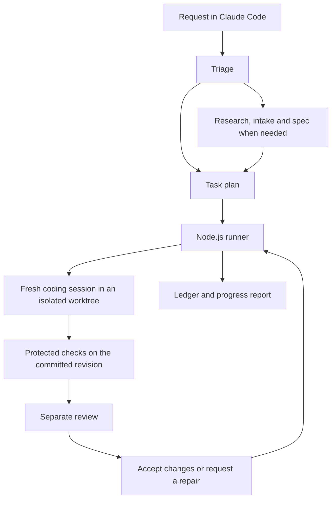

# Jarvis

A local orchestrator for AI coding agents, built in TypeScript.

Describe a feature or bug in Claude Code. Jarvis turns the request into a workflow: research and questions when the scope needs them, a plan, isolated coding sessions, then checks and review before accepting changes. A Node.js runner keeps the work moving between sessions and records what happened.

I’m building Jarvis for my own projects. The starting problem was a recruiter-finder feature: the coding agent began implementing before researching existing tools or understanding the workflow. I wanted a way to make those steps repeatable, and to check the resulting software instead of trusting a completion message.

**Status: experimental, under active development.** The build loop has completed a live bug fix that passed hidden tests. A later run reported completion but failed a hidden check. Reliability, broader task coverage, and installation on another machine are still being evaluated. This is a public development repository, not a finished v1 release.

[Getting started](docs/getting-started.md) · [Architecture](docs/03-architecture.md) · [Evaluation](docs/evaluation.md) · [Decisions](docs/01-decisions.md)

## What it does

The entry point is a Claude Code plugin:

```text
/jarvis feature: find the recruiter for each job I apply to
/jarvis fix: the citizenship filter is missing some jobs
```

The request determines the workflow. A small bug can go straight to debugging. A new product needs research, questions with recommended defaults, and a versioned spec before the build starts.

During a build, Jarvis runs tasks in fresh Claude Code sessions. It checks the committed code, requests a separate review, and sends failures back for repair. Accepted changes move onto the run branch. If a task cannot finish, the runner records it as blocked. You can inspect progress, leave a steering note, or read the report afterwards.

```sh
jarvis status
jarvis steer "Keep the existing API response format"
jarvis report
```

## How it works



The plugin handles the conversation. The runner owns execution, evidence, and state. Claude-specific integration lives behind an adapter in `packages/cli/src/harness/claude/`.

A few engineering choices shape the implementation:

- **Checks outside the agent’s workspace.** Approved acceptance checks live in a protected store. The runner records process output and exit codes, with assertions separated from candidate code.
- **Completion tied to a revision.** Checks and reviews must pass on the exact revision being accepted. Concurrent changes are checked again after integration.
- **State that survives interruption.** An append-only, hash-chained ledger records task transitions, approvals and evidence references. The runner uses it to rebuild state.
- **An approval broker for outside actions.** Task sessions cannot read stored credentials. Requests for supported actions go through a broker with approval records. Adapter coverage is still in development.
- **Model routing with escalation.** Builders start on Sonnet 5.5 and can escalate to Opus 5.5 after a failed check or review. Exploration uses Haiku 5.5. Codex is available for cross-model review; current benchmark runs use a Claude reviewer.

The sandbox must be available before unattended work starts. A live canary checks the pinned Claude Code installation and its safety settings. These boundaries have tests and mutation checks, but the project’s remaining validation work is tracked openly.

## What is built, and what is left

| Area | Implemented | Still being validated or completed |
|---|---|---|
| Intake | Request triage, research/design skills, questions, versioned specs and a decision register | Consistent research before questions, reliable defaults and repeated intake evaluations |
| Build loop | Task scheduling, isolated worktrees, repair attempts, model escalation, usage-limit waits and detached runs | Repeated success on real tasks and final stage evidence |
| Verification | Protected checks, separate review, evidence recording, security scanners and browser QA components | Full security/design/browser evaluations and sandboxed native app testing |
| Shipping and recovery | Release-state, smoke-test, rollback, memory and reporting components | Live shipping proofs and overnight tests with forced crashes and usage pauses |
| Distribution | CLI, Claude Code plugin, installer and MIT license | A clean installation on a second machine or fresh user account |

The current runtime targets macOS and Claude Code. Broader Codex and DeepSeek execution adapters are planned. Codex’s existing review integration does not make it a general task-execution backend.

## Try it locally

You need macOS, Node.js 24, pnpm 11.7.0, and an authenticated Claude Code 2.1.309 installation at `~/.local/share/claude/versions/2.1.309`. Jarvis checks exact binary versions. It requires at least 20 GB free disk; below 40 GB it limits writing tasks to one at a time.

```sh
git clone https://github.com/rodriguezzfabricio/jarvis.git ~/Developer/jarvis
cd ~/Developer/jarvis
scripts/install.sh --dry-run
scripts/install.sh
```

The installer adds a `jarvis` launcher and installs the Claude Code plugin. Then run these in your terminal:

```sh
jarvis setup
jarvis doctor --live
```

The live check uses your Claude account’s usage allowance. Open a disposable project in Claude Code, restart Claude Code if the plugin was just installed, and try `/jarvis fix: <your bug>`. Unattended builds require an approved plan and protected checks; setup alone does not prepare every project for a build.

See [getting started](docs/getting-started.md) for prerequisites, notifications, commands and troubleshooting. Use a disposable project while the remaining safety and recovery proofs are unfinished.

## How I’m evaluating it

Jarvis and plain Claude Code get sanitized copies of the same project. Hidden checks grade the final code from each run. Tests cover planted bugs and a recruiter-finder feature, with a wider set planned for intake, UI, security and overnight work.

The comparison records incorrect completion claims, hidden-test results, quality ratings, wall time and usage. Plain Claude uses Opus 5.5 in one session. Jarvis can use several sessions and models, so this measures the workflow with its additional compute, not an equal-budget model comparison.

Results are preliminary. The project has both passing and failing live runs, and two repetitions per task are insufficient to establish general reliability. The private evaluation repository contains personal project snapshots and hidden checks, so outsiders cannot currently reproduce the complete benchmark. [Evaluation methodology and limitations](docs/evaluation.md).

## Explore the code

| Path | Responsibility |
|---|---|
| [`packages/cli/src/runner/`](packages/cli/src/runner/) | Scheduling, worktrees, retries, model routing and task state |
| [`packages/cli/src/checks/`](packages/cli/src/checks/) and [`ledger/`](packages/cli/src/ledger/) | Protected execution and recorded evidence |
| [`packages/cli/src/broker/`](packages/cli/src/broker/) and [`harness/claude/`](packages/cli/src/harness/claude/) | Approvals, credentials and Claude Code isolation |
| [`plugin/`](plugin/) and [`skills/`](skills/) | The `/jarvis` entry point and workflow instructions |
| [`tests/`](tests/) | Unit tests, integration tests and optional live probes |

For local development:

```sh
pnpm install --frozen-lockfile
pnpm test
pnpm typecheck
```

Unit tests use a fake Claude process. Live probes require an authenticated account and consume usage. Mutation checks deliberately break safeguards to verify the tests detect them; they are substantially slower than the unit suite. Contributor rules are in [AGENTS.md](AGENTS.md).

## Built with AI assistance

I’m developing Jarvis with Claude Code and Codex. The repository includes design decisions, review findings and follow-up work so readers can inspect the process alongside the implementation. AI-generated work is subject to checks and separate review; live evaluation failures remain part of the project’s record.

## License

[MIT](LICENSE). Adapted skills, the vendored gitleaks rules and their licenses are listed in [credits](skills/CREDITS.md).
